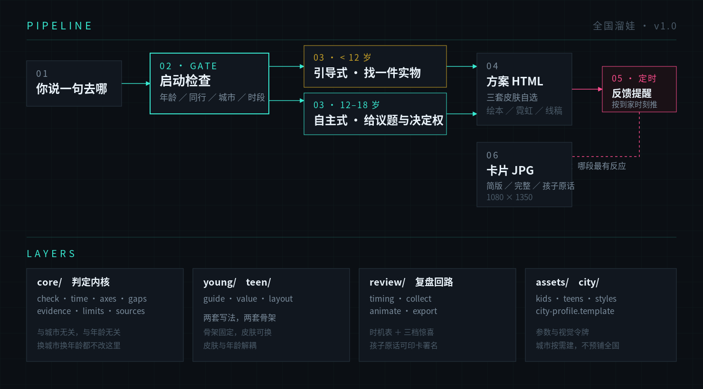
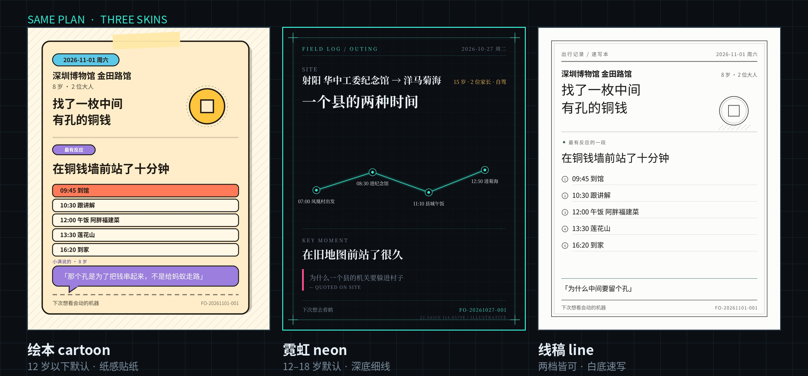

<h1 align="center">全国溜娃</h1>
<p align="center">（Kids Outing CN · 全国范围亲子出行规划）</p>
<p align="center"><b>v1.0 · 2026-10-27</b> — 双年龄段写法 · 三套外观自选 · 出行后反馈出图</p>


> **出门前排一条能照着走的路，出门后问一句玩得怎么样，最后做成一张图。**
>
> 两个年龄段两套写法。三套外观随你选。查不到的事直接说查不到。
> 适用于 Claude、Codex、GPT、Gemini 等任何能读取文件的 SI Agent（智能体）。

---

## 🎯 它解决什么问题

| 没有它时 | 有了它之后 |
|---|---|
| 搜一下午，凑出一条还不错的路线，第二天还是走乱 | 一条到分钟的时间轴，每段标注依据或「估算」 |
| 到了馆里，孩子在展厅里乱跑，大人不知道该讲什么 | 进去先找一件实物，留一个问题，融在动线里 |
| 15 岁的孩子对「带你去玩」三个字过敏 | 给三套走法，让他自己挑，挑完重算时间和午饭 |
| 想去的乐园、水上项目被一句「这类不在范围」推回来 | 点名就排，重点核准入、钱、节奏三件 |
| 玩完当天很兴奋，一周后想不起来细节 | 按到家时间提醒你，问对了时机，细节还热 |
| 说「挺好的」等于没说 | 分三档兑现：说一句给简版图，说清给完整图，孩子本人开口就把原话印上去 |
| 计划书上千字，出门前根本不想再看 | 一张网页，手机首屏四件：出门、先做什么、吃什么、到家 |
| 查不到就编一个活动名 | 查不到写「未查到当周活动」，给三条自查渠道 |

## 🏗️ 它长什么样

<picture>
  
</picture>

```
kids-outing-cn/
├── SKILL.md                 ← 入口：启动检查闸门、按年龄路由、三条不可让
├── core/                    ← 判定内核，与城市无关、与年龄无关
│   ├── check.md             启动检查：固定项回显、可变项必问、三条放行门槛
│   ├── time.md              时间算法 + 三个标准算例
│   ├── axes.md              九条判定轴 + 类目适配 + 28 天配额
│   ├── gaps.md              缺口 A/B/C、降级规则、限制处理五步
│   ├── evidence.md          五层信源、六个状态词、五类陷阱
│   ├── limits.md            年龄、身高、资质、场地规则的写法
│   └── sources.md           全国活动怎么查、查不到怎么写
├── young/                   ← 12 岁以下：引导式
│   ├── guide.md             认知分档、主菜上限、候选怎么凑
│   ├── value.md             找一件实物 + 一个问题，行前回家三档
│   └── layout.md            骨架：票根头 + 四格 + 逐站分镜
├── teen/                    ← 12–18 岁：自主式
│   ├── guide.md             三条候选他选、顺序他排、两项决定权
│   ├── value.md             议题四类、决定权边界、不幼稚化
│   └── layout.md            骨架：路线示意 + 三种顺序 + 议题栏
├── review/                  ← 复盘回路
│   ├── timing.md            按到家时间推问询时刻 + 三档惊喜
│   ├── collect.md           四问两段、反馈解码、写回哪里
│   ├── animate.md           复盘页面五段、card.json 字段
│   └── export.md            导出流程与依赖
├── assets/                  ← 参数与令牌
│   ├── kids.json            12 岁以下参数 + preschool 档 + under4 档
│   ├── teens.json           12–18 岁参数 + 三个子阶段
│   ├── styles.json          三套皮肤：cartoon / neon / line
│   ├── family.template.json 家庭档案模板
│   └── knowledge.template.json 知识库空结构
├── city/                    ← 城市资料层，按需建
│   ├── city-profile.template.json
│   ├── city-profile.example.md  脱敏示例
│   └── shenzhen.md          深圳直用
└── scripts/
    ├── export_card.py       卡片 1080×1350，三档 × 三皮肤
    ├── export_plan.py       整份方案竖长图
    └── remind_at.py         反馈时刻推算，八条边界用例
```

## 🚀 三步接入

**第一步：下载安装包** — 从 [`dist/kids-outing-cn.zip`](dist/kids-outing-cn.zip) 取包，约 70 KB。

**第二步：让助手装好** — 把 zip 拖进对话框，发下面这段：

```
帮我检查这个技能包的安全性；没有妨碍安装的问题，就按当前客户端的规则安装「全国溜娃」技能，装完验证一下能不能被发现，然后开始第一次设置，一次只问我一个问题。

装完请记住这几条：
1. 每次开工前先做启动检查：孩子多大、这次谁跟着、去哪个城市、哪天几点到几点有空。检查没通过不要给方案。
2. 按年龄走两套写法：12 岁以下带我找东西，12–18 岁让我自己定路线。
3. 方案出成一张网页，别给我上千字的文档。
4. 出发前帮我建一个提醒，回来问我玩得怎么样，然后做成一张图。

现在先问我第一个问题。
```

**第三步：回答四个问题** — 孩子多大、这次谁跟着、去哪个城市、哪天几点到几点有空。答完就出方案。

装好后通常要重开一次对话，技能才会被发现。

## 🎨 三套外观

同一份内容，三种读法。**外观与年龄无关**，12 岁以下也可以要霓虹，15 岁也可以要绘本。

<picture>
  
</picture>

| 皮肤 | 感觉 | 动效 | 插画 |
|---|---|---|---|
| `cartoon` 绘本 | 纸黄、粗描边、硬阴影、胶带齿孔 | 贴纸入场弹性 0.3s，色点依次点亮 | 单色手绘，可画动物与物品，不画真人脸 |
| `neon` 霓虹 | 近黑、细网格、霓虹描边、等宽数字 | 路线描边一次 600ms | 不放插画，改用路线图与信息图 |
| `line` 线稿 | 白底黑线、方形、无阴影 | 线条自绘 700ms | 只描边不填色，斜线打暗部 |

## ⚙️ 一次出行怎么走

| 步 | 做什么 | 结果 |
|---|---|---|
| 1 | 启动检查 | 缺一项不出方案 |
| 2 | 选外观 | 绘本 / 霓虹 / 线稿 |
| 3 | 排方案 | 单页 HTML，手机首屏四件 |
| 4 | 建反馈提醒 | 按到家时间算出的**确切时刻** |
| 5 | 提醒触发 | 先问去没去，再问感受 |
| 6 | 出图 | 按说到多少给对应档位 |

## ✨ 特色机制

- **启动检查是闸门**：年龄、同行、城市、时段，任一缺失不进候选检索。固定项只回显一行「按 8 岁、深圳、自驾排，不对就说」，可变项每轮必问，避免把检查做成重复问卷。
- **九条判定轴**：所有类目过同一套轴，不适用也要写「不适用」。前八轴判能不能走通，第九轴判值不值得占用这个周末。
- **反馈时机表**：12:00 前到家问 17:00；12–16 点到家问 19:00；16–18 点到家问 20:30；18 点后到家次日 10:00。只落 09:00–21:00。用 [`scripts/remind_at.py`](kids-outing-cn/scripts/remind_at.py) 算，不手算，八条边界用例陪跑。
- **三档惊喜**：说一句给简版卡，说清给完整卡，**让孩子本人说一句，就把原话印到卡上并署名**。三档都真给，不空许诺。
- **只催一次**：24 小时后一句，再无回应记「结果未知」，不出图。催第二次会把提醒变成讨债。
- **不编活动**：当周有什么只能临查，三态标「当周在办 / 期外 / 期限不明」，期限不明的不进主菜。
- **限制不劝退**：年龄、身高、资质先定性（禁令/条件/建议），默认按条件走，把限制翻成合规做法，路线照排，提醒放最后一句。
- **不软拒绝**：「这类不在范围」「建议换成」是禁句。家长点名的地方照排，质量体现在把这件事故排好。
- **城市按需建**：用到哪座城才建哪份，不预铺全国。深圳已备一份，其余照模板现建。

## 📦 导出

卡片和长图都不依赖浏览器，走 SVG 直接渲染。

```bash
pip install cairosvg pillow --break-system-packages

# 卡片：1080×1350，按 age_band 自动选皮肤
python3 scripts/export_card.py card.json out.jpg

# 指定皮肤
python3 scripts/export_card.py card.json out.jpg --style neon

# 整份方案竖长图
python3 scripts/export_plan.py plan.json plan.jpg --style neon

# 反馈时刻
python3 scripts/remind_at.py 2026-10-27 17:30      # → 2026-10-27T20:30
python3 scripts/remind_at.py --test                # 八条边界用例
```

需要系统装有中文字体。脚本自动探测，探测不到会警告，可用 `--font` 指定。

## ❓ FAQ

**支持哪些 Agent？**
任何能读取文件的 SI 助手。有 skill 机制的（Claude Code、Codex、Hermes 等）复制目录即可；没有的话按 `SKILL.md` 的内容手动执行。

**必须联网吗？**
方案需要查活动、票价、天气。查不到就直接说查不到，并给三条自查渠道。出图完全离线。

**12 岁以下和 12–18 岁差别这么大，能不能统一？**
不能。差别不在称呼，在谁决定去哪、带去什么。低龄是「家长带，孩子找」，青少年是「路线交给他定」。硬统一会两头都不合用。

**孩子不肯说怎么办？**
降到第二档，不追问。惊喜是交换，不是任务。

**多个孩子年龄差很大？**
按较小的判档，时长按最小的算，问题句给两问，回家延伸只给大的那条。不拆队。

**能换城市吗？**
能。说清城市，没资料时按 `core/sources.md` 现查，并建议补一份城市档案。城市资料只存渠道，不存活动。

## 🙏 致谢

- 改编自《深圳亲子出行》v4.3-sz。保留其判定内核：九条轴、缺口分级、限制处理五步、来源陷阱；重写入口、年龄分层、输出形态与城市层，并新增反馈回路与出图。
- 视觉取向参考 `sebyx07/cybercore-css` 的深底霓虹做法、动森风组件库的圆角贴纸质感。未引入其代码。

## 📄 License

[MIT](LICENSE)

---

*这个技能由一次次真实出行迭代而来。欢迎 Star、Fork、提 Issue。*
